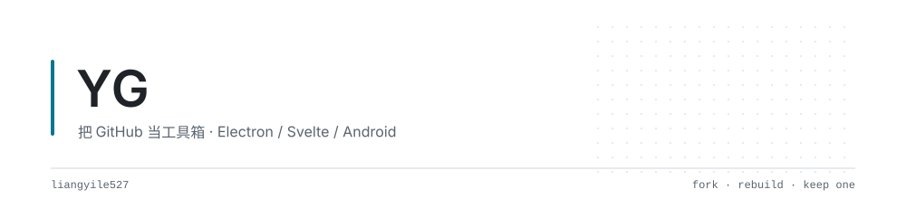
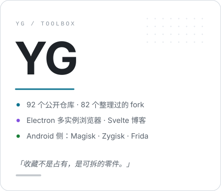

### 👋 Hi there

<!--
  模板：eryajf/eryajf（骨架 / 节奏 / 视觉层级完全照搬，内容全部换成 liangyile527 的真实数据）
  两份图：assets/header-*.svg（1000x220 横幅）、assets/side-card-*.svg（450x390 名片），双主题
  数据核对时间：2026-11-13 —— 92 个公开仓库（10 个自己写的 / 82 个 fork）、4 followers、44 following
  想改的只有一处：Location 徽章写的 LangFang 来自 GitHub 资料，搬了家就改那一行
-->

<picture>
  <source media="(prefers-color-scheme: dark)" srcset="assets/header-dark.svg">
  
</picture>

有个不太体面的习惯：遇到看不懂的东西，先存下来。

所以这个号看起来像个仓库——92 个公开仓库里，82 个是 fork。它们按用途分好类：Agent 编排、安全工具、Android 内核、代理网络、AI 资料。存的时候是囤积癖发作，用的时候才慢慢筛出来：真正会翻到第三次的，只有那么几类；剩下的只是当时觉得自己会看。

后来发现 fork 只是货架，真正学会是在改。**QianXi-Accounts** 是第一个从零写到底的 Electron 应用——多开浏览器，一个账号一套指纹，窗口之间互不相认；**fuwei-blog** 是拿来试 Svelte 的试验田；**Payloader-fake** 纯粹是想拆开别人的壳看看，拆完才发现壳里没剩多少东西，剩下的是自己得补的。

现在做的事很简单：把一件工具用到难受为止，再决定是改它，还是自己写一个。收藏夹越整理越短。**能用同一把刀切完的，就不加第二把。**

想说的其实很简单，就三点：

- 1，`先跑起来，再读代码`。看不懂的项目先让它跑通，报错比注释有用。跑通了再回头读，才知道每一行在防什么。
- 2，`能少一个依赖就少一个`。装的包越多，半年后回来就越不想碰。Electron 能原生做的就不引框架，CSS 能写完的就不上 UI 库。
- 3，`改别人的东西要留一行说明`。fork 不是占有，是借来用；自己动了哪里、为什么动，写清楚，将来还回去或者交给下一个人，都省事。

 

### 🤗 欢迎来访

> 

 
> 

### 🧰 语言工具

<table>
  <tr>
    <td></td>
    <td></td>
    <td></td>
    <td></td>
    <td></td>
    <td></td>
    <td></td>
  </tr>
</table>

  
  
  
  
  
  

### 💻 Stats

点击展开 ...

<picture>
  <source media="(prefers-color-scheme: dark)" srcset="https://github-profile-summary-cards.vercel.app/api/cards/profile-details?username=liangyile527&amp;theme=github_dark">
  
</picture>

<picture>
  <source media="(prefers-color-scheme: dark)" srcset="https://github-profile-summary-cards.vercel.app/api/cards/stats?username=liangyile527&amp;theme=github_dark">
  
</picture>
<picture>
  <source media="(prefers-color-scheme: dark)" srcset="https://github-profile-summary-cards.vercel.app/api/cards/most-commit-language?username=liangyile527&amp;theme=github_dark">
  
</picture>

<picture>
  <source media="(prefers-color-scheme: dark)" srcset="https://streak-stats.demolab.com?user=liangyile527&amp;theme=onedark&amp;hide_border=true&amp;date_format=Y.n.j">
  
</picture>

<picture>
  <source media="(prefers-color-scheme: dark)" srcset="https://raw.githubusercontent.com/liangyile527/liangyile527/output/snake-dark.svg">
  
</picture>

### 🗂 工具箱（82 个 fork 按用途分好类）

> 这里只列我真正会翻回去用的。星标属于上游作者，不替我加分；仓库名点进去就是原件。

| 分类 | 里面有什么 |
| :-- | :-- |
| 🤖 **Agent 编排** | [openclaw-skills](https://github.com/liangyile527/Fork-awesome-openclaw-skills) · [openclaw-tutorial](https://github.com/liangyile527/Fork-awesome-openclaw-tutorial) · [openclaw-usecases](https://github.com/liangyile527/Fork-awesome-openclaw-usecases) · [openclaw-zero-token](https://github.com/liangyile527/Fork-openclaw-zero-token) · [CLIProxyAPI](https://github.com/liangyile527/Fork-CLIProxyAPI) · [cc-haha](https://github.com/liangyile527/Fork-cc-haha) · [system-prompts 合集](https://github.com/liangyile527/Fork-system-prompts-and-models-of-ai-tools) · [prompts.chat](https://github.com/liangyile527/Fork-prompts.chat) |
| 🛡 **安全 / 渗透 / CTF** | [VulnClaw](https://github.com/liangyile527/Fork-VulnClaw) · [LuaN1aoAgent](https://github.com/liangyile527/Fork-LuaN1aoAgent) · [ctfSolver](https://github.com/liangyile527/Fork-ctfSolver) · [BUUCTF_Agent](https://github.com/liangyile527/Fork-BUUCTF_Agent) · [Tsec-Hackathon](https://github.com/liangyile527/Fork-Tsec-Hackathon) · [info-gathering](https://github.com/liangyile527/Fork-info-gathering) · [有害文本检测](https://github.com/liangyile527/Fork-Chinese-offensive-language-detect) |
| 📱 **Android 内核 / 模块** | [ReSukiSU](https://github.com/liangyile527/Fork-ReSukiSU) · [ZygiskFrida](https://github.com/liangyile527/Fork-ZygiskFrida) · [Zygisk-Il2CppDumper](https://github.com/liangyile527/Fork-Zygisk-Il2CppDumper) · [mkpms](https://github.com/liangyile527/Fork-mkpms--) · [Pixel 10 Pro spoof](https://github.com/liangyile527/Fork-Pixel-10-Pro-spoof-magisk-module) · [Pixelify](https://github.com/liangyile527/Fork-Pixelify) · [OShin](https://github.com/liangyile527/Fork-OShin) |
| 🌐 **网络 / 代理 / 系统** | [hysteria](https://github.com/liangyile527/Fork-hysteria) · [MIHOMO_YAMLS](https://github.com/liangyile527/Fork-MIHOMO_YAMLS) · [free-proxy-list](https://github.com/liangyile527/Fork-free-proxy-list) · [node-ws](https://github.com/liangyile527/Fork-node-ws) · [Docker-OSX](https://github.com/liangyile527/Fork-Docker-OSX) · [macos-iso-builder](https://github.com/liangyile527/Fork-macos-iso-builder) · [upx](https://github.com/liangyile527/Fork-upx) |
| 🧰 **桌面效率** | [tidebalance](https://github.com/liangyile527/Fork-tidebalance) · [MayeNano](https://github.com/liangyile527/Fork-MayeNano) · [ContextMenuManager](https://github.com/liangyile527/Fork-ContextMenuManager-new) · [Github-Store](https://github.com/liangyile527/Fork-Github-Store) · [cmdzh](https://github.com/liangyile527/Fork-cmdzh) · [ActionController](https://github.com/liangyile527/Fork-ActionController) · [process_watch2txt](https://github.com/liangyile527/Fork-process_watch2txt) |
| 📚 **AI 资料** | [Hello-AI](https://github.com/liangyile527/Fork-Hello-AI) · [ai-guide](https://github.com/liangyile527/Fork-ai-guide) · [free-llm-api-resources](https://github.com/liangyile527/Fork-free-llm-api-resources) · [awesome-generative-ai](https://github.com/liangyile527/Fork-awesome-generative-ai) · [generative-ai-for-beginners](https://github.com/liangyile527/Fork-generative-ai-for-beginners) · [ai-Register](https://github.com/liangyile527/Fork-ai-Register) |
| 🔧 **拆解素材** | [WeChatDataAnalysis](https://github.com/liangyile527/Fork-WeChatDataAnalysis) · [ComfyUI](https://github.com/liangyile527/Fork-ComfyUI) · [playwright](https://github.com/liangyile527/Fork-playwright) · [3DSource 弦光](https://github.com/liangyile527/3DSource-Xianguang-Source) · [trackerslist](https://github.com/liangyile527/Fork-trackerslist) |

### 🏊 自己写的

点击展开 ...

|                                      Project                                       |                                                   Stars                                                    |                                                   Forks                                                    |              Remark              |
| :--------------------------------------------------------------------------------: | :--------------------------------------------------------------------------------------------------------: | :--------------------------------------------------------------------------------------------------------: | :------------------------------: |
| [QianXi-Accounts](https://github.com/liangyile527/QianXi-Accounts) |  |  | 千禧 accounts —— Electron 多实例浏览器，一号一指纹 |
| [fuwei-blog](https://github.com/liangyile527/fuwei-blog) |  |  | Svelte 写的博客，试验田 |
| [Payloader-fake](https://github.com/liangyile527/Payloader-fake) |  |  | TypeScript，拆别人的壳用 |
| [Copilot-Claw](https://github.com/liangyile527/Copilot-Claw) |  |  | 养 Agent 的壳，实验用 |
| [Copilot-Claw-Real](https://github.com/liangyile527/Copilot-Claw-Real) |  |  | 同一件事的认真版 |
| [htmltest](https://github.com/liangyile527/htmltest) |  |  | 早期练手的 HTML 页面 |

### 📝 最近在做

点击展开 ...

- 🌐 **QianXi-Accounts** —— 多实例浏览器往「一个窗口一套指纹」上继续推，环境隔离比多开更麻烦 · `2026-11-12`
- 🧪 **fuwei-blog** —— Svelte 5 的 runes 试到路由和 transition，笔记顺手写进仓库 · `2026-11-01`
- 🎨 **3DSource 弦光** —— 把一套 3D 素材站的源码拉下来读结构 · `2026-10-20`
- 💬 **WeChatDataAnalysis** —— 微信 4.x 本地库解密与导出，看它怎么处理实时更新 · `2026-10-19`
- 🕰️ **tidebalance** —— 时间块 + 四象限那套插件的组织方式，比自己重写一遍省事 · `2026-09-12`
- 🍎 **macos-iso-builder** —— 纯 Actions 出 macOS 安装镜像，验证流程能跑到哪一步 · `2026-05-26`

### 🥇 Badges

<picture>
  <source media="(prefers-color-scheme: dark)" srcset="https://raw.githubusercontent.com/liangyile527/liangyile527/trophy/trophy-dark.svg">
  
</picture>

  
  
  
  

收藏不是占有，是可拆的零件。

