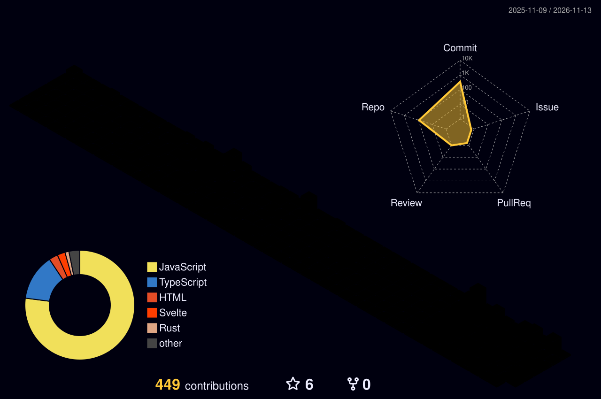

[;%E6%94%B6%E8%97%8F%E6%98%AF%E4%B8%BA%E4%BA%86%E6%8B%86%E5%BC%80%E7%9C%8B%EF%BC%8C%E6%94%B9%E9%80%A0%E6%89%8D%E7%AE%97%E5%AD%A6%E4%BC%9A%EF%BC%81&center=true&size=27)](https://git.io/typing-svg)

<picture>
  <source media="(prefers-color-scheme: dark)" srcset="./assets/images/coding.gif" />
  <source media="(prefers-color-scheme: light)" srcset="./assets/images/developer.svg" height="225px" />
  
</picture>

&nbsp;

  &emsp;
  &emsp;
  &emsp;
  

<picture>
  <source media="(prefers-color-scheme: dark)" srcset="https://raw.githubusercontent.com/liangyile527/liangyile527/output/snake-dark.svg" />
  <source media="(prefers-color-scheme: light)" srcset="https://raw.githubusercontent.com/liangyile527/liangyile527/output/snake.svg" />
  
</picture>

#  🙋 Hello

<table>

<tr><td>

### 🤺 About Me

&emsp;&emsp;嗨，你好，我是 <strong>YiLe Liang</strong>，廊坊。白天拧螺丝，晚上拆轮子。

&emsp;&emsp;这个号里 90 多个仓库，绝大多数是 fork —— 别人的工具我先跑起来，再回头读它是怎么跑起来的。改一行算一次学习。

&emsp;&emsp;喜欢把花哨的东西做小，把该有的体验做实；一个依赖能省就省，一句注释该留就留。

&emsp;&emsp;<strong>Collecting is not owning. Take it apart, then make it yours.</strong>

</tr></td>

<tr><td>

### 📃 最近在做

- Nov 13 - [这个主页：换成 sun0225SUN 那套骨架，数据全换自己的](https://github.com/liangyile527/liangyile527)
- Nov 12 - [QianXi-Accounts：Electron 多实例浏览器管理器](https://github.com/liangyile527/QianXi-Accounts)
- Nov 01 - [fuwei-blog：Svelte 写的博客，还在新手测试阶段](https://github.com/liangyile527/fuwei-blog)
- Oct 20 - [弦光源码：fork 过来自己动手改](https://github.com/liangyile527/3DSource-Xianguang-Source)
- Sep 12 - [潮衡：时间块四象限，本地优先](https://github.com/liangyile527/Fork-tidebalance)

</td></tr>

<tr><td>

### 📊 提交节律

<picture>
  <source media="(prefers-color-scheme: dark)" srcset="https://github-profile-summary-cards.vercel.app/api/cards/productive-time?username=liangyile527&amp;theme=github_dark&amp;utcOffset=8" />
  <source media="(prefers-color-scheme: light)" srcset="https://github-profile-summary-cards.vercel.app/api/cards/productive-time?username=liangyile527&amp;theme=default&amp;utcOffset=8" />
  
</picture>
<picture>
  <source media="(prefers-color-scheme: dark)" srcset="https://github-profile-summary-cards.vercel.app/api/cards/repos-per-language?username=liangyile527&amp;theme=github_dark" />
  <source media="(prefers-color-scheme: light)" srcset="https://github-profile-summary-cards.vercel.app/api/cards/repos-per-language?username=liangyile527&amp;theme=default" />
  
</picture>

</td></tr>

</table>

  <picture>
    <source media="(prefers-color-scheme: dark)" srcset="https://readme-jokes.vercel.app/api?hideBorder&amp;bgColor=%23121212" />
    <source media="(prefers-color-scheme: light)" srcset="https://readme-jokes.vercel.app/api?hideBorder&amp;bgColor=%23ffffff" />
    
  </picture>

<picture>
  <source media="(prefers-color-scheme: dark)" srcset="https://streak-stats.demolab.com?user=liangyile527&amp;theme=onedark&amp;hide_border=true&amp;date_format=Y.n.j" />
  <source media="(prefers-color-scheme: light)" srcset="https://streak-stats.demolab.com?user=liangyile527&amp;theme=default&amp;hide_border=true&amp;date_format=Y.n.j" />
  
</picture>

<picture>
  <source media="(prefers-color-scheme: dark)" srcset="https://github-profile-summary-cards.vercel.app/api/cards/profile-details?username=liangyile527&amp;theme=github_dark" />
  <source media="(prefers-color-scheme: light)" srcset="https://github-profile-summary-cards.vercel.app/api/cards/profile-details?username=liangyile527&amp;theme=default" />
  
</picture>

 

<table>
  <tr>
    <td>
      <picture>
        <source media="(prefers-color-scheme: dark)" srcset="https://github-profile-summary-cards.vercel.app/api/cards/stats?username=liangyile527&amp;theme=github_dark" />
        <source media="(prefers-color-scheme: light)" srcset="https://github-profile-summary-cards.vercel.app/api/cards/stats?username=liangyile527&amp;theme=default" />
        
      </picture>
    </td>
    <td>
      <picture>
        <source media="(prefers-color-scheme: dark)" srcset="https://github-profile-summary-cards.vercel.app/api/cards/most-commit-language?username=liangyile527&amp;theme=github_dark" />
        <source media="(prefers-color-scheme: light)" srcset="https://github-profile-summary-cards.vercel.app/api/cards/most-commit-language?username=liangyile527&amp;theme=default" />
        
      </picture>
    </td>
  </tr>
</table>

 

 

<!-- devicon 图标墙（techstack-generator 已收费，换 devicon @ jsdelivr） -->

 

 

<!-- gif -->

<picture>
  <source media="(prefers-color-scheme: dark)" srcset="./profile-3d-contrib/profile-night-rainbow.svg" />
  <source media="(prefers-color-scheme: light)" srcset="./profile-3d-contrib/profile-gitblock.svg" />
  
</picture>

<table>
  <tr>
    <td></td>
  </tr>
  <tr>
    <td>
      <picture>
        <source media="(prefers-color-scheme: dark)" srcset="https://raw.githubusercontent.com/liangyile527/liangyile527/trophy/trophy-dark.svg" />
        <source media="(prefers-color-scheme: light)" srcset="https://raw.githubusercontent.com/liangyile527/liangyile527/trophy/trophy.svg" />
        
      </picture>
    </td>
  </tr>
</table>

模板骨架来自 <a href="https://github.com/sun0225SUN/sun0225SUN">sun0225SUN</a>，图片素材一并取自该仓库；数字、文案、语言环全是本号真实数据。

